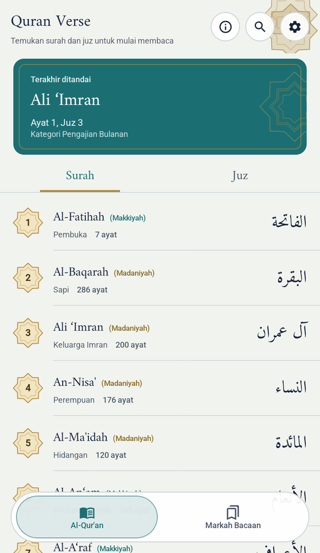
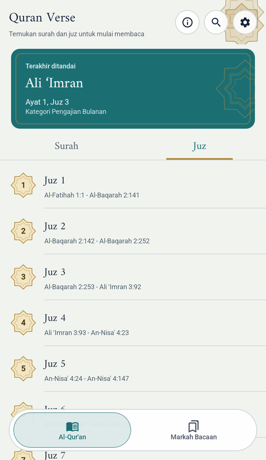
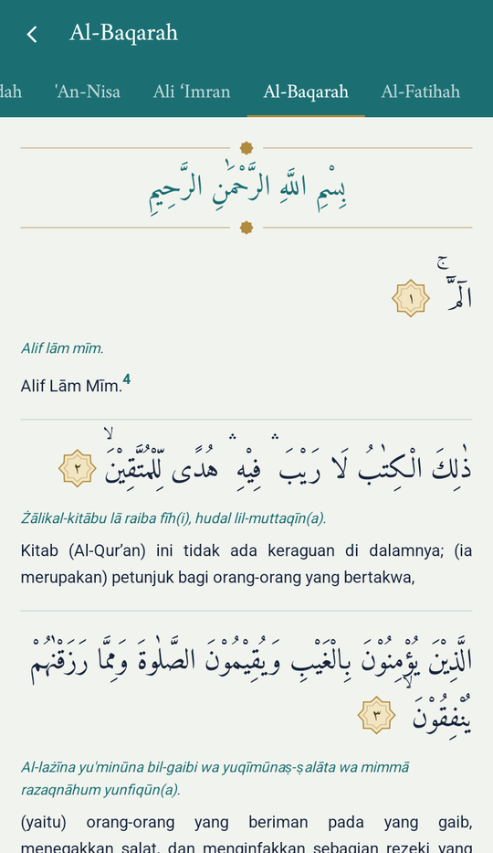
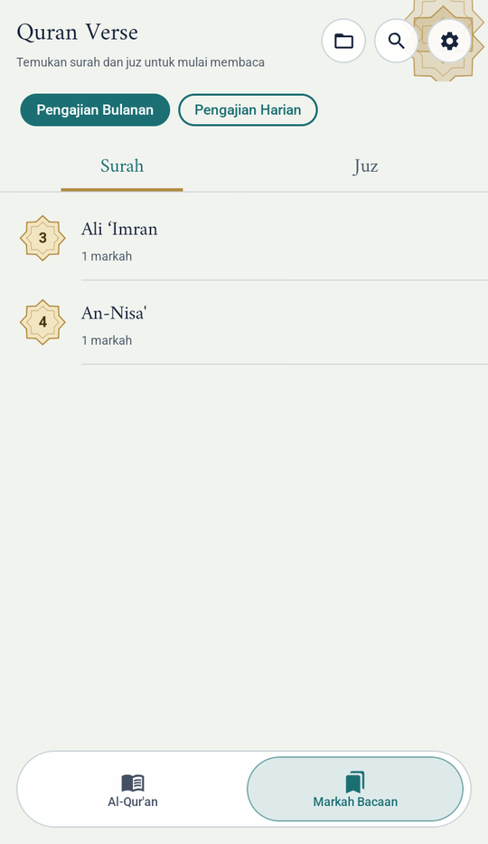
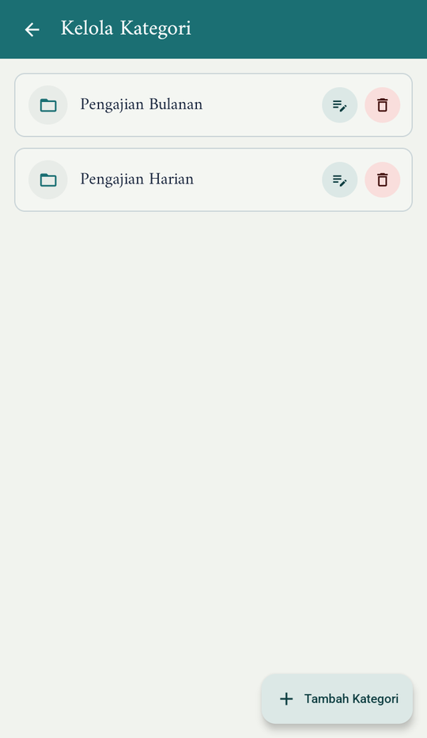
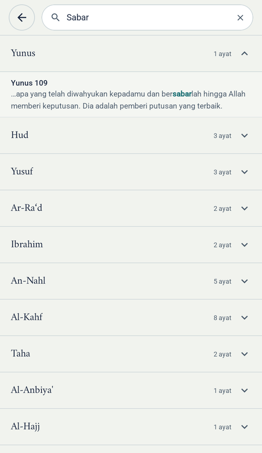
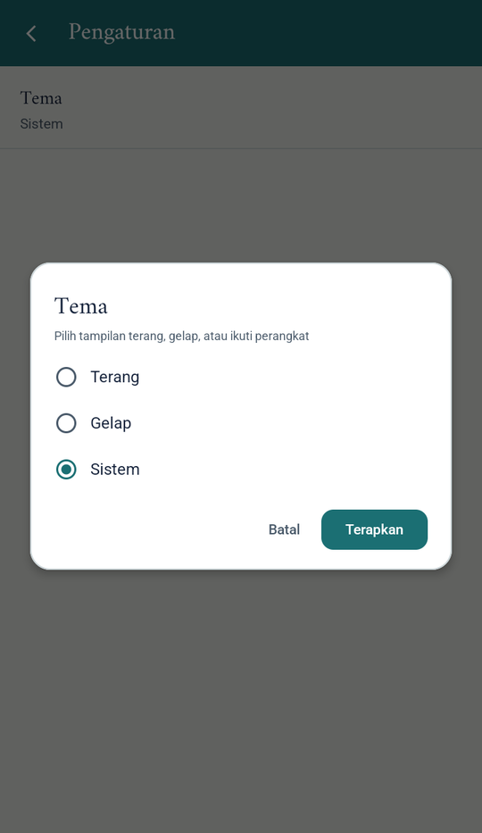
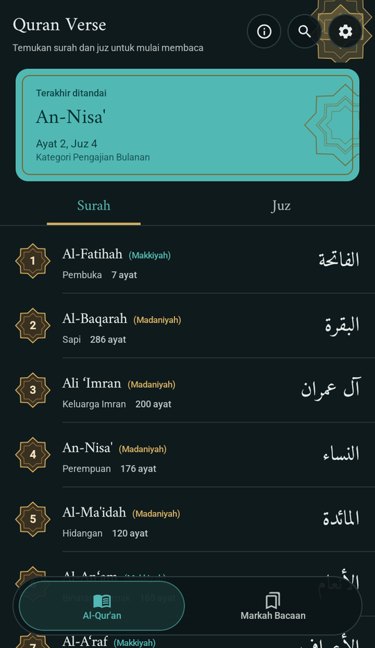

# Quran Verse

Aplikasi Al-Qur'an untuk Android yang bisa dibaca tanpa internet: teks Arab, transliterasi Latin, dan terjemahan Indonesia lengkap dengan catatan kaki, disertai markah ayat, pencarian, dan tema terang/gelap.

> **Versi 1.0.0.** Lihat [CHANGELOG](CHANGELOG.md) untuk daftar perubahan.

## Daftar Isi

- [Fitur](#fitur)
- [Tangkapan Layar](#tangkapan-layar)
- [Teknologi](#teknologi)
- [Arsitektur](#arsitektur)
- [Struktur Proyek](#struktur-proyek)
- [Memulai](#memulai)
- [Pengujian](#pengujian)
- [Sumber Data dan Hak Cipta](#sumber-data-dan-hak-cipta)
- [Privasi](#privasi)
- [Lisensi](#lisensi)
- [Kontak](#kontak)

## Fitur

- **Baca per surah dan per juz.** 114 surah dan 30 juz, dengan teks Arab, transliterasi, dan terjemahan Indonesia. Catatan kaki berupa angka bertautan di dalam terjemahan, dan diketuk untuk membuka penjelasannya.
- **Bacaan terakhir.** Kembali ke ayat terakhir yang ditandai langsung dari beranda.
- **Markah ayat.** Tandai ayat dan kelompokkan ke dalam kategori yang bisa ditambah, diubah namanya, dan dihapus.
- **Pencarian.** Cari surah berdasarkan nama atau cari ayat berdasarkan kata di transliterasi dan terjemahan Indonesia.
- **Tema.** Terang, gelap, atau mengikuti sistem. Pilihan baru berlaku setelah menekan *Terapkan*, dan bisa dibatalkan.
- **Kirim masukan.** Tombol di Pengaturan yang membuka Gmail (atau aplikasi surel lain bila Gmail tidak ada) dengan alamat pengembang dan subjek sudah terisi.
- **Sumber data.** Penjelasan asal data Al-Qur'an dan atribusinya tersedia di dalam aplikasi, di Pengaturan.
- **Offline.** Seluruh isi disimpan di perangkat, tidak perlu koneksi internet.
- **Antarmuka berbahasa Indonesia**, dengan bilah navigasi bawah berefek kaca (*glassmorphism*), dirancang untuk orientasi potret.

## Tangkapan Layar

| Beranda | Daftar juz | Layar baca | Markah |
|:---:|:---:|:---:|:---:|
|  |  |  |  |

| Kelola kategori | Pencarian | Pilihan tema | Tema gelap |
|:---:|:---:|:---:|:---:|
|  |  |  |  |

## Teknologi

| Bidang | Yang dipakai |
|---|---|
| Bahasa | Kotlin |
| UI | Jetpack Compose, Material 3 |
| Navigasi | Navigation Compose |
| Injeksi dependensi | Hilt |
| Database lokal | Room (database terisi dari *asset*) |
| Penanganan galat | Arrow (`Either`) |
| Efek kaca | [glassmorphism-compose](https://github.com/neilyich/glassmorphism-compose) |
| Font Arab | Amiri |
| Pengujian | JUnit 4, kotlinx-coroutines-test, Robolectric, Compose UI Test, JaCoCo |
| Build | Gradle (Kotlin DSL), version catalog (`libs.versions.toml`), KSP |

Versi pustaka dikelola di [`gradle/libs.versions.toml`](gradle/libs.versions.toml).

**Persyaratan perangkat:** Android 8.0 (API 26) ke atas. `targetSdk` 37.

## Arsitektur

Aplikasi memakai **Clean Architecture** per fitur dengan pola **MVVM** dan aliran data satu arah.

```
presentation   →   domain   ←   data
(screen, ViewModel,  (entity, repository   (data source, mapper,
 state, event)        interface, use case,   implementasi repository)
                      failure)
```

Aturan antarmodul:

- Modul **feature** hanya boleh bergantung pada `core` dan `ui-kit`, tidak pada feature lain.
- `core` tidak boleh bergantung pada modul feature.
- Pengecualian: `feature-bottomNavigation` merangkai fitur-fitur lain dan menjadi satu-satunya modul yang mengenal banyak feature.

Penanganan galat:

- Setiap fitur punya `Failure` bertipe (turunan `AppFailure` di `core`) dan `Exception` penanda (turunan `AppException`).
- Repository mengembalikan `Either<Failure, T>`.
- Teks pesan galat hanya ada di lapisan presentation, satu tempat per fitur (`toMessage()`).

State layar memakai `StateFlow<UiState>` (`Initial`, `Loading`, `Success`, `Error`), dan peristiwa sekali jalan (misalnya *Toast*) lewat `Channel`.

## Struktur Proyek

```
QuranVerse/
├── app/                      # titik masuk aplikasi, Hilt, tema, ikon
├── core/                     # kode lintas fitur: database Room, markah, failure/exception dasar
├── ui-kit/                   # komponen UI bersama: tema, warna, font, dialog, tombol, efek kaca
├── feature-quran/            # daftar surah/juz dan layar baca
├── feature-bookmark/         # markah ayat dan kategorinya
├── feature-search/           # pencarian surah dan ayat
├── feature-theme/            # pengaturan tema
└── feature-bottomNavigation/ # bilah navigasi bawah yang merangkai fitur
```

Setiap modul punya `src/test/` berisi unit test dan Compose UI test. Penjelasannya ada di [Pengujian](#pengujian).

## Memulai

Prasyarat: Android Studio versi terbaru dan JDK 17.

1. Clone repositori, lalu buka folder proyek di Android Studio.
2. Letakkan berkas database Al-Qur'an di `core/src/main/assets/database/quran.db`. Berkas ini tidak disertakan di repositori (lihat [Sumber Data dan Hak Cipta](#sumber-data-dan-hak-cipta)).
3. Tunggu Gradle sync selesai, lalu jalankan modul `app` di perangkat atau emulator Android 8.0 (API 26) ke atas.

Lewat terminal:

```powershell
.\gradlew.bat assembleDebug
```

## Pengujian

Proyek ini punya **unit test** (JUnit 4 dan kotlinx-coroutines-test) dan **Compose UI test** (Compose UI Test yang dijalankan oleh Robolectric). Keduanya berjalan di komputer tanpa emulator atau ponsel:

```powershell
.\gradlew.bat testDebugUnitTest
```

Cakupan baris diukur dengan JaCoCo, dengan ambang minimal 80% per modul:

```powershell
.\gradlew.bat :<modul>:coverageCheck
```

Penjelasan lengkap (alat, pola fake, konfigurasi, cakupan, dan cara menambah test) ada di [docs/TESTING.md](docs/TESTING.md).

## Sumber Data dan Hak Cipta

Data Al-Qur'an dalam aplikasi ini (teks Arab, transliterasi, terjemahan Indonesia, dan catatan kaki) **diambil dari repositori [data-quran](https://github.com/mamun-al-abdullah/quran)**, bukan diambil langsung oleh penulis aplikasi dari situs Kementerian Agama. Repositori itu mengumpulkan datanya dari berbagai sumber, di antaranya **Lajnah Pentashihan Mushaf Al-Qur'an (LPMQ), Kementerian Agama Republik Indonesia** ([quran.kemenag.go.id](https://quran.kemenag.go.id)).

- Situs resmi LPMQ mencantumkan *Copyright © LPMQ — All Rights Reserved*. Hak atas teks dan terjemahan itu **tetap milik LPMQ**, dan **tidak termasuk** dalam lisensi kode proyek ini.
- Aplikasi ini **bukan aplikasi resmi** dan tidak berafiliasi dengan Kementerian Agama atau LPMQ.
- Berkas database Al-Qur'an tidak disertakan di repositori ini.
- **Atribusi:** repositori [data-quran](https://github.com/mamun-al-abdullah/quran) berlisensi [CC BY-NC-ND 4.0](https://creativecommons.org/licenses/by-nc-nd/4.0/) dan, menurut keterangannya, dikumpulkan oleh tim Hablullah dari berbagai sumber, di antaranya Tanzil, QuranEnc, dan situs LPMQ Kemenag. Aplikasi ini hanya mengubah format data ke SQLite, tanpa mengubah isinya, dan sesuai syarat lisensi itu tidak digunakan secara komersial (tanpa iklan dan tanpa pembelian dalam aplikasi).
- Jika Anda menemukan kesalahan pada teks, silakan laporkan lewat [Kontak](#kontak).
- Penjelasan ini juga ada di aplikasi: Pengaturan, lalu **Sumber data**.

Aset lain: font (Amiri dan Roboto, SIL Open Font License 1.1) dan pustaka pihak ketiga (Apache-2.0 dan MIT) mengikuti lisensinya masing-masing. Daftar dan teks lengkapnya ada di [THIRD_PARTY_LICENSES.md](THIRD_PARTY_LICENSES.md).

## Privasi

- Aplikasi **tidak meminta izin apa pun** dan tidak memerlukan koneksi internet.
- Markah, kategori, dan pilihan tema disimpan **hanya di perangkat Anda**, dan tidak dikirim ke server mana pun. Aplikasi sendiri tidak mengunggah data itu. Jika cadangan Android aktif di perangkat Anda, sistem Android dapat mencadangkannya ke akun Google Anda, tetapi pemulihannya tidak dijamin, dan data **bisa hilang jika aplikasi dihapus atau datanya dibersihkan**.
- Tombol **Kirim masukan** hanya membuka Gmail atau aplikasi surel Anda. Aplikasi tidak mengirim apa pun sendiri, dan isi surel (termasuk keterangan versi aplikasi dan perangkat yang terisi otomatis, yang bisa Anda ubah atau hapus) baru terkirim jika Anda menekan kirim.
- Aplikasi **tidak menampilkan iklan** dan tidak memiliki pembelian dalam aplikasi.

## Lisensi

**Kode sumber** proyek ini dilisensikan di bawah [Lisensi MIT](LICENSE).

Lisensi itu **hanya berlaku untuk kode**. Hal-hal berikut **tidak tercakup** dan tetap mengikuti pemiliknya masing-masing:

- Data Al-Qur'an (teks Arab, transliterasi, terjemahan, dan catatan kaki): berasal dari repositori data-quran dan LPMQ, bukan karya penulis aplikasi. Lihat [Sumber Data dan Hak Cipta](#sumber-data-dan-hak-cipta).
- Font (Amiri dan Roboto) dan pustaka pihak ketiga: lisensinya masing-masing, lihat [THIRD_PARTY_LICENSES.md](THIRD_PARTY_LICENSES.md).

## Kontak

Muhammad Sutan Fathir — muhammadsutanfathir@gmail.com
